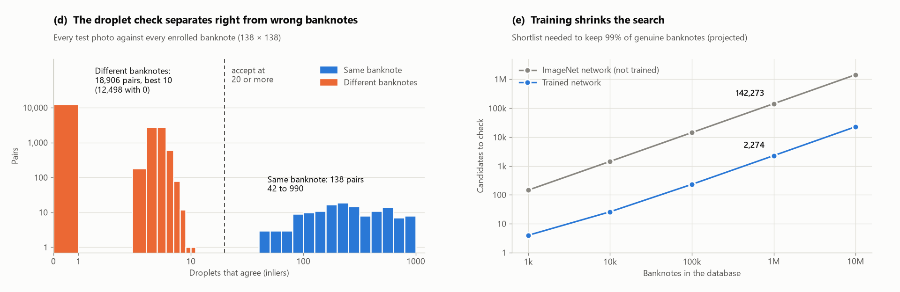
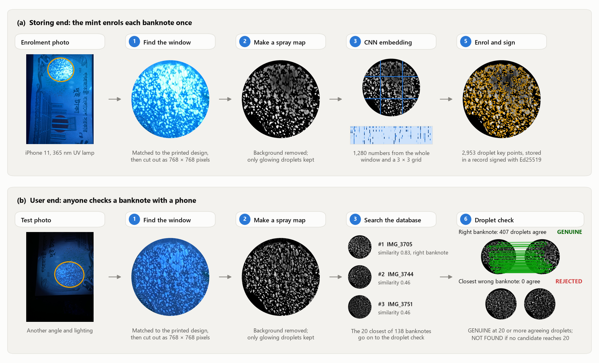
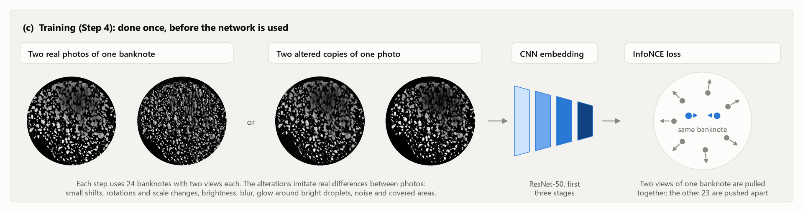

# Photoluminescent Entropy Signatures (PES)

Code for the field-level authentication method in Section 2.5 of:

> T. Pramanik, R. Mustari, R. D. Prangan, F. Sharmin, A. A. Hamim, M. R. Hosen, M. S. Islam and M. A. Rahman, *Alkali-Mediated Hierarchical Defect Fingerprinting of Luminescent ZnO Nanohexagons for Multilevel Security Encoding*, submitted, 2026.

Na-ZnO nanohexagon ink is sprayed onto the watermark window of a banknote. The droplets land at random, so under UV light every banknote shows its own pattern of glowing dots that nobody can spray again. This code registers each banknote from a phone photo at the mint (storing end). Later it identifies the banknote from a new photo taken at another angle and under other lighting (user end), using the spray pattern alone, without a serial number.

On 138 sprayed 2-Taka banknotes, every test photo was matched to the right banknote. Same-banknote photos shared 42 to 990 matching droplets, while no pair of different banknotes reached more than 10, against an accept threshold of 20.

<picture>
  <source media="(prefers-color-scheme: dark)" srcset="figures/results_dark.png">
  
</picture>

*(d) Every test photo checked against every enrolled banknote. The two groups never overlap. (e) How many banknotes the search must hand to the droplet check so that 99% of genuine banknotes are still found. Database sizes above 138 are projected from the measured scores.*

## How it works

<picture>
  <source media="(prefers-color-scheme: dark)" srcset="figures/how_it_works_dark.png">
  
</picture>

*One banknote from the paper going through the pipeline. Top: the mint enrols it from one photo. Bottom: a photo taken later at another angle finds it again. The search only shortlists candidates; the droplet check makes the decision.*

| Step | What happens | Code |
|---|---|---|
| 1. Find the window | SIFT points on the printed design around the window are matched to a template, and a perspective transform is fitted with RANSAC (MAGSAC++). The window is cut out as a 768 × 768-pixel image, with printed lines inside it masked. | `pes/registration.py`, `pes/template.py` |
| 2. Make a spray map | The local background is subtracted and only spots brighter than their surroundings are kept, which makes photos under different lamps comparable. | `pes/imaging.py` |
| 3. Describe the pattern | A ResNet-50 (first three stages, no classification layer) turns the spray map into an embedding, pooled with GeM over the whole window and over a 3 × 3 grid. | `pes/fingerprint.py` |
| 4. Train the network | Contrastive training (InfoNCE) on pairs of photos of the same banknote and altered copies, with five-fold cross-validation over banknotes. | `pes/train.py`, `pes/scaling.py` |
| 5. Enrol | The embedding goes into a vector database (Qdrant). The droplet key points (RootSIFT) are stored in a record signed with the mint's Ed25519 private key. | `pes/pipeline.py`, `pes/store.py`, `pes/ledger.py` |
| 6. Verify | The 20 closest banknotes are checked droplet by droplet. The score is the number of droplets that agree on one alignment (inliers). 20 or more means GENUINE. | `pes/matching.py`, `pes/pipeline.py` |

<picture>
  <source media="(prefers-color-scheme: dark)" srcset="figures/training_dark.png">
  
</picture>

*Step 4. The network learns that two views of the same banknote belong together, whatever the angle or lighting, and that views of different banknotes do not.*

## Repository contents

```
pes/          the Python package (command line: python -m pes)
assets/       template of the 2023 2-Taka banknote front used in Step 1
models/       trained embedding used in the paper (34 MB)
examples/     two photos of one sprayed banknote, for a quick test
results/      outputs behind every number in Section 2.5 (see results/README.md)
figures/      the figures in this README and figures/make_figures.py, which draws them
```

## Installation

Python 3.10 or newer. Tested on Windows 11 with Python 3.14, PyTorch 2.11 (CUDA 12.8) and an NVIDIA RTX 3060.

```bash
git clone https://github.com/ErenDexter/photoluminescent-entropy-signatures.git
cd photoluminescent-entropy-signatures
python -m venv .venv
# Windows: .venv\Scripts\activate      Linux/macOS: source .venv/bin/activate
pip install torch torchvision --index-url https://download.pytorch.org/whl/cu128   # or the CPU build
pip install -r requirements.txt
```

Run all commands from the repository root. Commands without `--weights` use the untrained ImageNet network; the first such run downloads its weights through torchvision.

## Quick start

Enrol the banknote from its first photo, then verify the second photo:

```bash
python -m pes --weights models/pes_embed.pt --db-dir data/demo_db enroll examples/IMG_3705.HEIC
python -m pes --weights models/pes_embed.pt --db-dir data/demo_db verify examples/IMG_3850.HEIC --vis data/demo_vis
```

The verdict is `GENUINE` for banknote `IMG_3705` with about 400 agreeing droplets. The first run also creates the mint's key pair in `data/keys/`. `--vis` writes an image of the matched droplets.

## Reproducing the paper's results

The full photo set (276 photos of 138 banknotes) is available from the corresponding author on reasonable request. It has two folders: `1st Angle` (enrolment photos) and `2nd Angle` (test photos).

```bash
# End-to-end test with the untrained ImageNet network, plus every test photo against every banknote
python -m pes evaluate --gallery "photos/1st Angle" --queries "photos/2nd Angle" --out data/eval/imagenet --all-pairs

# The same test with the trained network
python -m pes --weights models/pes_embed.pt evaluate --gallery "photos/1st Angle" --queries "photos/2nd Angle" --out data/eval/trained

# Training with five-fold cross-validation over banknotes, then a final model on all banknotes
# (about 15 min on an RTX 3060)
python -m pes train --gallery "photos/1st Angle" --queries "photos/2nd Angle" \
    --pairs results/evaluation_imagenet/results.csv --save data/models/pes_embed.pt

# Redraw the figures in this README
python figures/make_figures.py --gallery "photos/1st Angle"
```

`evaluate` uses its own fresh database and keys. It runs three tests: identification without an ID, a claimed-ID check, and unregistered banknotes (half of the banknotes are removed from the database and their photos must be rejected). `train` takes the photo-to-banknote pairing from the `results.csv` that `evaluate` writes.

`results/README.md` lists which file gives each number in the paper. The one-million-banknote shortlist sizes are projections from the measured scores, not measurements. The cross-validated numbers in `results/training/train_report.json` are measured on banknotes the network had not seen. The saved model was trained on all 138 banknotes.

## Using it on other banknotes

```bash
python -m pes enroll "photos/1st Angle"                        # one banknote per photo, ID = file name
python -m pes enroll a.jpg b.jpg --note-id BD-2-000123          # several photos of one banknote
python -m pes verify photo.heic                                 # which banknote is this?
python -m pes verify photo.heic --claim BD-2-000123             # check against a claimed serial number
python -m pes verify "photos/2nd Angle" --json                  # a folder, machine-readable output
python -m pes list | info | delete <note_id>
```

| Verdict | Meaning |
|---|---|
| `GENUINE` | The pattern matches an enrolled banknote (and the claimed ID, if one was given). |
| `MISMATCH` | The pattern is genuine but belongs to a different banknote than the claimed ID. |
| `NOT_FOUND` | The pattern matches no enrolled banknote: counterfeit or never registered. |
| `UNREADABLE` | The banknote or its window was not found in the photo. Take another photo. |

The user end needs only `data/keys/mint_public.pem` and read access to the database. Enrolment rejects a photo that cannot be aligned and a pattern that already belongs to another banknote. To use a Qdrant server instead of the embedded store, put `{"qdrant_url": "http://localhost:6333"}` in a JSON file and pass `--config file.json`. All settings are in `pes/config.py`.

The template in `assets/template/` is for the front of the 2023 2-Taka note. It was built with:

```bash
python -m pes build-template --reference "photos/1st Angle/IMG_3641.HEIC" --rotate 180 --scale 0.5 \
    --crop 80 240 1120 1440 --roi 490 850 250 294 --name BDT-2-2023-front \
    --mask-from "photos/1st Angle" "photos/2nd Angle" --preview assets/template_preview.jpg
```

For another banknote design, choose a sharp reference photo, give the crop box around the window and the window ellipse (in pixels after `--rotate` and `--scale`), and point `--mask-from` at photos of at least 10 different sprayed banknotes.

## Limitations

All photos were taken with one phone (iPhone 11) and one 365 nm UV lamp, on 138 freshly sprayed banknotes. Worn or folded banknotes, other phones and lamps, and deliberate copies made with fluorescent ink have not been tested yet.

## Citation

Please cite the paper above. `CITATION.cff` has the details in machine-readable form.

## License

MIT, see `LICENSE`.
